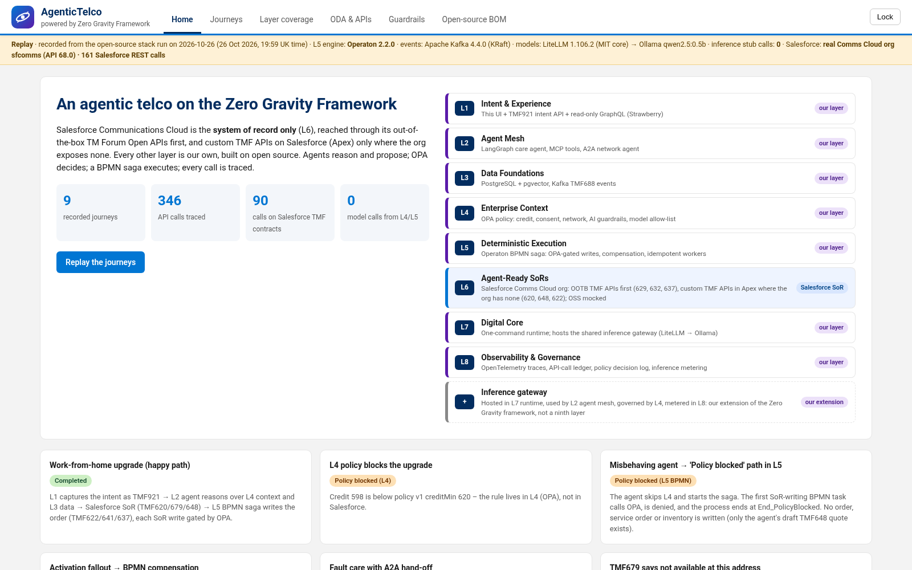
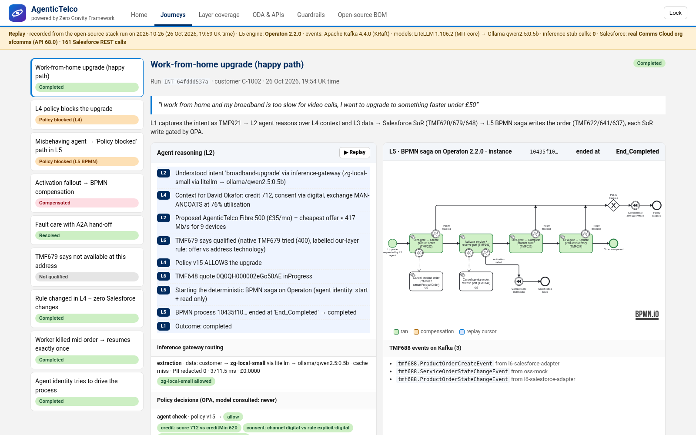

# AgenticTelco – powered by Zero Gravity Framework

AgenticTelco is a working concept demo of an agentic telco built on the eight layers of Tech Mahindra's **Zero Gravity Telco
Architecture**.

- **Salesforce Communications Cloud is the system of record only (L6).** It is reached through its out-of-the-box TM Forum
  Open APIs first. Where the org exposes no usable native API, we use custom TMF APIs on Salesforce (Apex REST in TMF shapes).
- **Every other layer is our own and built on open source.** Agents reason and propose, OPA decides, an Operaton BPMN saga
  executes, and every call is traced with its ODA block, owner and runtime.




> Concept demo by Lalit Chauhan · not an official Salesforce product. It is not affiliated with or endorsed by Tech Mahindra or TM Forum.

## Zero Gravity in one paragraph

Tech Mahindra launched Zero Gravity on **9 Sep 2026** [1]. It is an architectural paradigm, not a product. It is described
in a **55-page report** [2b] and positioned as part of TechM Helix [3][4]. The core idea:

- Rules, semantics and policy are lifted out of BSS/OSS into an Enterprise Context layer (the "Zero Gravity Axiom").
- Legacy systems are thinned into agent-ready systems of record.
- Agents act through a deterministic, compensating execution fabric.

The **8 layers** [2b p.21–22]:

| Layer | Name |
|---|---|
| L1 | Intent & Experience |
| L2 | Agent Mesh |
| L3 | Data & Intelligence Foundations |
| L4 | Context Layer |
| L5 | Deterministic Execution Fabric |
| L6 | Agent-Ready SoRs |
| L7 | Digital Core |
| L8 | Observability & Governance |

The report names no specific TMF Open APIs and no Salesforce role. This demo's API mapping is our own.

Sources:
- [1] TechM press release, 9 Sep 2026: https://www.techmahindra.com/insights/press-releases/techm-unveils-zero-gravity-telco-architecture-to-accelerate-ai-native-telco-transformation/
- [2b] *Zero Gravity Telco Architecture™* report (PDF, 55 pp.): https://insights.techmahindra.com/assets/zero-gravity-telco-architecture.pdf
- [3] TechM Q2 FY27 earnings call transcript, 15 Oct 2026: https://insights.techmahindra.com/investors/tml-q2-fy-27-earnings-transcript.pdf
- [4] TechM Q2 FY27 earnings presentation: https://insights.techmahindra.com/investors/tml-q2-fy-27-earnings-presentation.pdf

## Architecture (what runs where)

| Layer | AgenticTelco builds | Runtime |
|---|---|---|
| L1 Intent & Experience | TMF921 intent API (**not supported by Salesforce – our layer**), password-gated replay UI, read-only GraphQL (Strawberry) | ours |
| L2 Agent Mesh | LangGraph care agent, MCP tools, A2A network agent. Agents may only **start and read** L5 processes | ours |
| L3 Data Foundations | PostgreSQL 17 + pgvector data products; TMF688 events on Apache Kafka 4.4.0 (KRaft) | ours |
| L4 Enterprise Context | OPA 1.21.4: credit, consent, network safety, AI guardrails, model allow-list. Rules change with zero Salesforce changes | ours |
| L5 Deterministic Execution | **Operaton 2.2.0 BPMN** saga: OPA gate before every SoR write ("Policy blocked" end event), compensation, idempotent workers, shown in bpmn-js with the bpmn.io watermark visible | ours |
| L6 Agent-Ready SoRs | **Salesforce Comms Cloud org** (see below); OSS (TMF641/645/621) mocked | Salesforce |
| L7 Digital Core | One-command runtime; hosts the inference gateway (**LiteLLM MIT core**, hosted in L7 runtime, used by L2 agent mesh) → local Ollama | ours |
| L8 Observability & Governance | OpenTelemetry spans, API-call ledger tagged by ODA block, owner and runtime; policy decision log; inference metering | ours |

### L6 on the real org (`sfcomms`, API 68.0)

| API | Runtime label | How |
|---|---|---|
| TMF629 Customer, TMF632 Party (individual, organization) | **OOTB** | Native Direct Access TMF APIs |
| TMF637 Product Inventory | **OOTB** | Native GET by id; writes use standard sObject REST on `Asset` (native POST returns 405) |
| TMF620 Product Catalog, TMF648 Quote, TMF622 Product Order | **custom TMF API on Salesforce** | `AgenticTelco_` Apex REST at `/services/apexrest/agentictelco/tmf<NNN>/…`. The org has no usable native path |
| TMF679 POQ | OOTB tried, then **our layer** (labelled) | Native call returns 400 "No Default Qualification Procedure is set". Org setup is left unchanged |
| TMF921 Intent | **our layer** | Not supported by Salesforce |

The full probe results, including TMF621/651/667/671 and GraphQL, are in [docs/api/org-capabilities.md](docs/api/org-capabilities.md).
The decision is recorded in [docs/adr-amendments/001](docs/adr-amendments/001-custom-tmf-apis-on-salesforce.md).

- **Catalogue:** the product catalogue is native EPC data (standard objects only, no Apex/Flow in the seed). See
  [docs/dev/epc-seed.md](docs/dev/epc-seed.md).
- **TMF620/648 caveat:** Salesforce documents TMF620 and TMF648 as certified, but this org exposes neither on any Direct
  Access or managed-package path. The demo therefore serves them as **custom TMF APIs on Salesforce**, not as Salesforce's
  certified implementation. The UI and ledger label every call so nobody mistakes one for the other.

## Journeys (recorded against the real org)

| # | Journey | What it proves |
|---|---|---|
| 1 | Work-from-home upgrade (happy path) | Intent → agent plan → OPA → BPMN saga → TMF648 quote → TMF622 order → OSS → TMF637 inventory → TMF688 events |
| 2 | L4 policy blocks the upgrade | The credit rule in OPA denies before anything is written |
| 3 | Misbehaving agent | BPMN OPA gate before the SoR write → **"Policy blocked"** end event |
| 4 | Activation fallout | BPMN compensation cancels the TMF622 order (`CancelProductOrder`) |
| 5 | Fault care with A2A hand-off | The care agent opens a TMF621 trouble ticket (OSS mocked) and hands off to the network agent over A2A |
| 6 | Multi-gig not available | TMF679 (native tried → labelled our-layer rule) says unqualified; nothing written |
| 7 | Change the rule in L4 only | Same customer passes after a policy-data change; 0 Salesforce changes |
| 8 | Worker killed mid-order | SIGKILL during TMF641, then resume with exactly one service order (idempotency) |
| 9 | Agent identity guardrails | Agents can start and read processes; complete, modify, suspend, delete and deploy are refused; L4/L5 cannot call a model |

Results are in [TEST_RESULTS.md](TEST_RESULTS.md). The replay on Pages is labelled "recorded from the open-source stack
run on <date>". It replays a recording and makes no live calls.

## Run it

```bash
./run.sh setup                           # venvs; tools in .tools/ (see docs/runbook.md)
./run.sh up                              # stand-in SoR (no Salesforce needed)
ZG_SOR_MODE=commscloud ./run.sh up       # real org via the Salesforce CLI alias sfcomms (server-side only)
ZG_SOR_MODE=commscloud ./run.sh journeys # resets AgenticTelco demo inventory, records recordings/run-<date>.json
./run.sh test                            # unit, OPA, stack, web build and Playwright e2e
cd web && npm ci && node build.js        # needs TF_DEMO_PASSWORD or a git-ignored .demo-password
```

More detail in [docs/runbook.md](docs/runbook.md). The container variant (`docker-compose.yml`) is provided but **was not
run** for this recording.

## Bill of materials

Everything is OSI-licensed apart from Salesforce, the one commercial component:

- Operaton 2.2.0 (Apache-2.0)
- Apache Kafka 4.4.0 (Apache-2.0)
- PostgreSQL 17 + pgvector (PostgreSQL Licence)
- OPA 1.21.4 (Apache-2.0)
- LangGraph, MCP SDK, FastAPI, Strawberry (MIT)
- LiteLLM 1.106.2, MIT core only (`litellm-enterprise` uninstalled)
- Ollama + Qwen2.5-0.5B (MIT / Apache-2.0)
- OpenTelemetry (Apache-2.0)
- bpmn-js (MIT + watermark condition)

Licence rules:

- **GraphQL:** this demo uses Strawberry (MIT). If an Apollo component is ever added, use Apollo Server (MIT) only. Apollo Router (Elastic Licence v2) is excluded.
- **LiteLLM and Langfuse:** MIT cores only, with no `enterprise/` or `ee/` code.
- **bpmn-js:** the bpmn.io watermark stays visible.
- **Excluded:** Camunda 8, Redpanda and Restate.

The full table is in `web/src/bom.json` and in the BOM view of the UI.

**Alternative for L5:** Temporal can play the same role as the deterministic execution fabric (durable workflows with code-level
compensation). This demo chose Operaton so the saga is a visible, auditable BPMN model.

## Security

- **Demo page:** the published page is one HTML file whose app and recording are encrypted with **AES-256-GCM**. The key is
  derived with PBKDF2-SHA256 at 250,000 iterations. The password is never committed, logged or stored in the page.
- **Salesforce access:** Salesforce is reached only server-side through the Salesforce CLI session. No token is held in
  code, in the browser bundle or in the recording.
- **Org writes:** the adapter and Apex create only AgenticTelco-prefixed records and never issue DELETE.
- **Local secrets:** these are in `.data/secrets.env`, which is git-ignored and never shipped.
- **Inference:** customer data goes only to local or sovereign models (an OPA rule enforces this).

## Docs

- `docs/runbook.md`: setup, ports, operations.
- `docs/api/`:
  - OpenAPI specs of our services.
  - GraphQL schema.
  - Salesforce call catalogue.
  - Org capability check.
- `docs/dev/`:
  - EPC seed.
  - ADR 0001 (LiteLLM in L7).
- `docs/adr-amendments/`: ADR amendment 001 (custom TMF APIs on Salesforce).
- `docs/architecture/`: the architecture pack (owned separately).
- `salesforce/`: the Apex classes, tests and deploy IDs.
