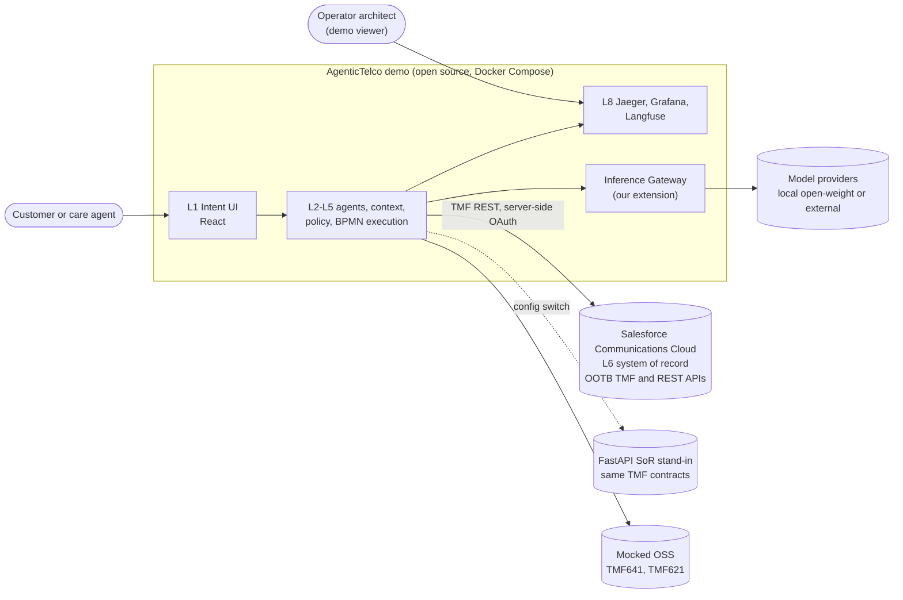
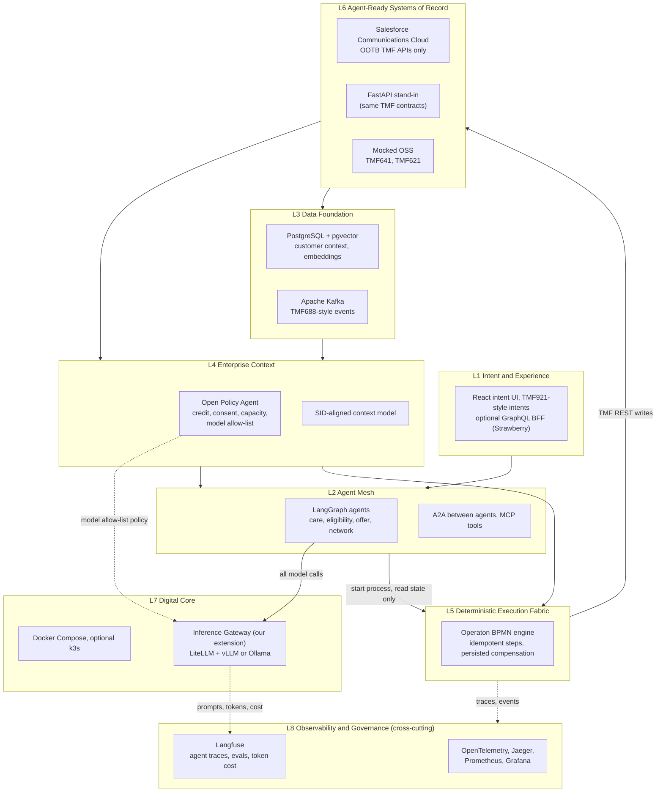

# 01 · Architecture overview

## 1. Executive summary
- **What the demo shows (RECOMMENDED):** an agentic broadband upgrade, from a customer's stated intent to a completed order, built on the 8-layer Zero Gravity North Star. AI agents reason and propose. A deterministic BPMN process executes. Policy-as-code decides. Salesforce Communications Cloud only holds the records.
- **Zero Gravity (CONFIRMED):** Tech Mahindra's *Zero Gravity Telco Architecture™* report (9 Sep 2026) is an architectural paradigm, not a product. It defines eight layers and the **Zero Gravity Axiom**: rules and policies are "fully externalized, with zero residual left inside any agent-ready SoR" ([report](https://insights.techmahindra.com/assets/zero-gravity-telco-architecture.pdf), PDF p.24).
- **How the demo applies the Axiom (RECOMMENDED):** eligibility, credit, consent and network-capacity rules live in Open Policy Agent (L4). The order steps live in an Operaton BPMN process (L5). Salesforce holds only canonical state (L6), with no custom rules in the org.
- **Standards position (INFERRED):** the demo is *conceptually aligned* with TM Forum ODA functional blocks and uses TMF Open API contracts. It is **not** ODA-certified. See [03](03-api-event-sid-mapping.md#conceptual-alignment-vs-certified-conformance).
- **Open source (RECOMMENDED, licences CONFIRMED in [06](06-tech-stack-and-licences.md)):** everything outside Salesforce is open source. Camunda 8, Redpanda and Restate were rejected on licence grounds.
- **Honesty on screen (RECOMMENDED):** anything the Salesforce org does not expose runs on a FastAPI stand-in that honours the same TMF contract, and is labelled "stand-in" on screen. Which TMF APIs the trial org exposes is **UNKNOWN** until tested.

## 2. Use case: agentic broadband upgrade (care-to-order)
1. Customer states an intent ("faster broadband for home working"), captured as a TMF921-style intent (L1).
2. Agents (L2) assemble context (L3) and check eligibility.
3. OPA (L4) evaluates credit, consent and network-capacity policies.
4. Operaton (L5) runs the order process: TMF679 qualification → TMF648 quote → TMF622 product order → TMF641 service order (mocked OSS) → TMF637 inventory update.
5. On failure, the process runs persisted compensation steps; fallout is raised as a TMF621 trouble ticket.
6. Every step emits TMF688-style events to Kafka and traces to OpenTelemetry and Langfuse (L8).

## 3. System context

## 4. Layer model
The layer names and arrows follow Figure 3 of the report (PDF p.21). The demo components are our mapping (RECOMMENDED). The Inference Gateway is **our extension**: the report discusses inference *cost* ("Token Economics", printed p.35) but defines no inference layer or gateway.

**Reading the diagram:**
- Solid arrows follow Figure 3 of the report, plus the agent-to-gateway call. Dotted arrows are governance and telemetry.
- The Inference Gateway is a shared platform service hosted in L7 next to the runtime. L2 agents consume it. OPA (L4) holds its model allow-list. Langfuse (L8) meters and traces it. It is **not a ninth layer** (INFERRED/RECOMMENDED).
- OPA policies and Operaton BPMN steps never call a model (ADR-003, ADR-009).

## 5. Responsibility matrix
| Layer | Owns (in the demo) | Must not do | Components | Label |
|---|---|---|---|---|
| L1 Intent & Experience | Capture intent, show plan, process diagram, "stand-in" badges | Call Salesforce directly; hold secrets | React; optional GraphQL BFF | RECOMMENDED |
| L2 Agent Mesh | Understand intent, gather context, propose a plan, start a process, explain outcomes | Complete, skip or alter BPMN tasks; write to any SoR; call models except through the gateway | LangGraph, A2A, MCP | RECOMMENDED |
| L3 Data Foundation | Customer context, embeddings, event log | Hold business rules | PostgreSQL + pgvector, Kafka | RECOMMENDED |
| L4 Enterprise Context | All decision rules: credit, consent, capacity, model allow-list; SID-aligned vocabulary | Execute orders; call models | OPA (Rego), context model | RECOMMENDED |
| L5 Execution Fabric | Order process, retries, idempotency keys, compensation, fallout path | Make policy decisions itself (it asks OPA); call models | Operaton | RECOMMENDED |
| L6 Systems of Record | Canonical state: party, catalogue, quote, order, inventory | Hold eligibility, pricing-policy or orchestration rules we add | Salesforce Comms Cloud (OOTB APIs), FastAPI stand-in, mocked OSS | RECOMMENDED |
| L7 Digital Core | Runtime, networking, secrets injection, Inference Gateway hosting | — | Docker Compose, optional k3s, LiteLLM, vLLM/Ollama | RECOMMENDED |
| L8 Observability & Governance | Traces, metrics, agent reasoning traces, evals, token cost, audit | — | OpenTelemetry, Jaeger, Prometheus, Grafana, Langfuse | RECOMMENDED |

## 6. What is real and what is mocked
| Element | Status | Label |
|---|---|---|
| Salesforce org | Communications Cloud 30-day trial on Salesforce Platform has been created | REPORTED (by the team; not inspected for this pack) |
| TMF APIs the trial org actually exposes | Not yet tested | UNKNOWN |
| OSS (service order, trouble ticket) | Mocked | CONFIRMED (design decision) |
| Billing | Out of scope | CONFIRMED (design decision) |
| Public GitHub Pages site | Replay of recorded real runs, password-gated | RECOMMENDED (ADR-006) |
