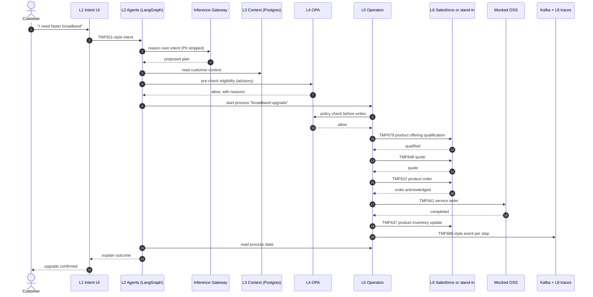
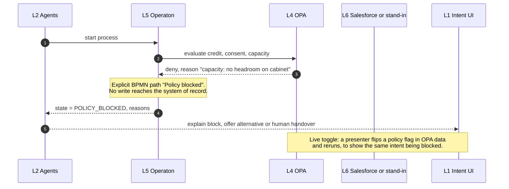
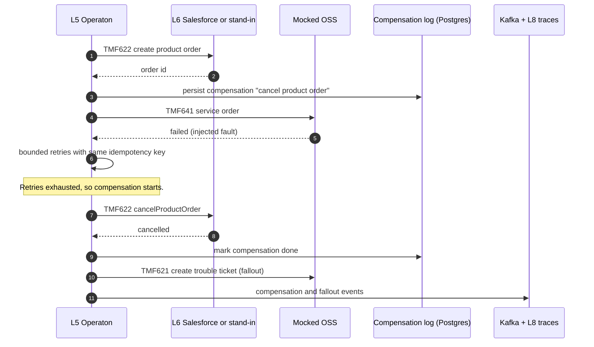
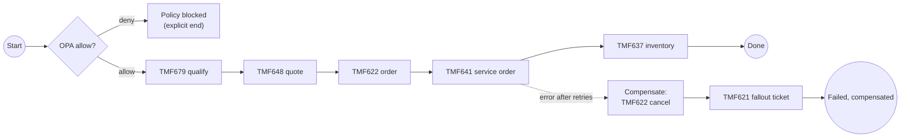

# 02 · Sequences and flows

All three flows are the demo design (RECOMMENDED). API names are TM Forum Open API contracts. Whether each call reaches Salesforce or the stand-in depends on what the trial org exposes, which is UNKNOWN until verified (see [03](03-api-event-sid-mapping.md)).

**Rules that apply to every flow (ADR-003):**
- Agents only **start** a process and **read** its state. They never complete, skip or modify BPMN tasks.
- Every BPMN task that writes to Salesforce calls OPA first. A policy "deny" follows an explicit BPMN path.
- OPA and BPMN steps never call a language model. Only agents do, and only through the Inference Gateway.
- Each step uses an idempotency key (process instance ID plus step name), so a retry does not create a duplicate.

## 1. Happy path

The agent's OPA pre-check is advisory, to give a fast explanation. The binding check is the one the BPMN task makes before it writes (RECOMMENDED).

## 2. Policy block

## 3. Compensation and fallout

## 4. BPMN process outline

This outline is the design intent (RECOMMENDED). The BPMN XML in the repo is the source of truth once DevBot commits it.

## 5. Notes on SoR write semantics (INFERRED)
- TMF622 v5 defines a `cancelProductOrder` task resource ([TMF622 v5 OAS](https://github.com/tmforum-apis/TMF622_ProductOrder)). Whether the Salesforce org supports cancellation through it is **UNKNOWN**.
- Salesforce documents TMF641 as an **outbound** integration (Salesforce calls an external service-order system) via MuleSoft Direct Integrations ([Salesforce doc](https://developer.salesforce.com/docs/industries/communications/guide/get_started_industry_integrations.html)). In the demo, our BPMN process calls the mocked OSS directly, so Salesforce's outbound TMF641 is not used (RECOMMENDED).
