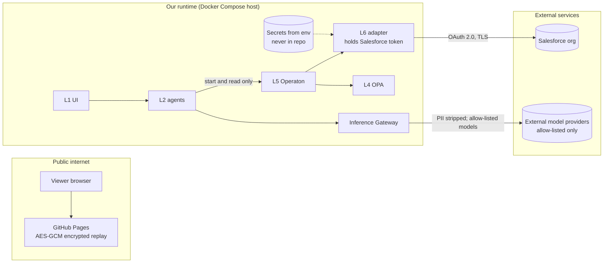

# 05 · Security and governance

Everything here is the demo design (RECOMMENDED) unless labelled otherwise. This is a demo, not a production security design.

## 1. Non-negotiable rules
| # | Rule | Where enforced |
|---|---|---|
| S1 | Salesforce credentials exist **only** server-side (runtime environment or secret store). Never in the browser, static site, repo, logs, traces or chat. | L7 secrets injection; `.gitignore`; secret scanning in CI |
| S2 | The demo page password comes from an environment variable at build time and is never committed. | Build script; CI secret |
| S3 | Agents never write to a SoR and never complete or skip BPMN tasks. | Operaton authorisations (ADR-003); tests |
| S4 | Every SoR write is preceded by an OPA decision recorded in the trace. | BPMN task template; OPA decision logs |
| S5 | No customer personal data leaves our boundary to a non-allow-listed model. | Inference Gateway + OPA allow-list (ADR-009) |
| S6 | No custom logic in the Salesforce org. | ADR-001; org change review |

## 2. Trust boundaries

## 3. Salesforce access
- **Recommended:** an OAuth 2.0 connected app (or External Client App) with the client credentials or JWT bearer flow, running as a dedicated integration user with least-privilege permission sets. Salesforce's TMF620 guide requires a connected app and OAuth 2.0 for the TMF APIs ([doc](https://developer.salesforce.com/docs/industries/communications/guide/TMF620.html), CONFIRMED). Salesforce's Pub/Sub API guide also recommends OAuth for production ([doc](https://developer.salesforce.com/docs/platform/pub-sub-api/guide/qs-python-quick-start.html), CONFIRMED).
- **Not recommended:** a stored username, password and security token. If used temporarily for the trial org, keep it in the server environment only and rotate it after the event.
- The integration user's permissions also limit what GraphQL reads return, because the GraphQL API enforces object and field permissions ([doc](https://developer.salesforce.com/docs/platform/graphql/guide/query-record-objects.html), CONFIRMED).
- Tokens are never sent to L1 or returned in API responses. Traces redact `Authorization` headers.

## 4. Demo page encryption
- The static replay page is encrypted with AES-GCM; a key is derived from the password in the browser (for example PBKDF2 with a high iteration count and random salt).
- **Limitation (INFERRED):** anyone who downloads the page can try passwords offline. Use a long random password, share it out of band, and rotate it after each event. Never put real customer data, credentials or tokens in recordings.
- The repo must contain only the encrypted output, never the plaintext page or the password.

## 5. Policy governance (OPA, L4)
| Policy | Purpose | Inputs | Toggle |
|---|---|---|---|
| Credit | Block upgrade if account is in arrears | Account balance status from context | Yes, live |
| Consent | Block if no marketing or processing consent for the upgrade offer | Consent flags | Yes, live |
| Network capacity | Block if the access node has no headroom | Mocked capacity data | Yes, live |
| Model allow-list | Allow only listed models per data class (for example personal data → local or UK models) | Data class, model ID, provider region | Yes |

- Policies are Rego files in the repo, with unit tests (`opa test`). Policy changes go through pull request review.
- OPA decision logs (input, result, policy version) are kept for every decision and linked to the trace ID.
- The live toggle changes OPA **data**, not Rego code, so the audit trail shows exactly what changed. RECOMMENDED.

## 6. AI governance (L2, L8)
- Agent prompts, tool calls, model, tokens and cost are traced in Langfuse; system traces in OpenTelemetry/Jaeger. Both share a trace ID with the BPMN process instance.
- Agents have no write tools for SoRs. MCP tools exposed to agents are read-only or "start process".
- Evaluations: a fixed set of intents (happy path, policy block, compensation) is replayed before each demo build; results are stored with the recording. RECOMMENDED.
- UK GDPR: personal data minimised in prompts; residency enforced by the gateway; recordings use synthetic customers only. RECOMMENDED. Legal review of these controls has not been done. UNKNOWN.

## 7. Audit trail per order (RECOMMENDED)
Each completed or failed order can be reconstructed from: intent ID → agent trace (Langfuse) → process instance (Operaton history) → OPA decision logs → TMF requests and responses (OpenTelemetry spans) → TMF688-style events (Kafka) → SoR record IDs.
