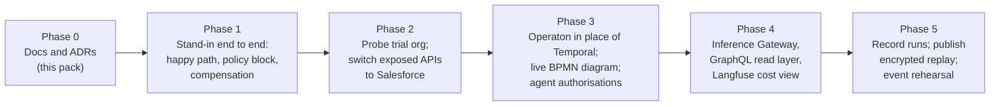

# 07 · Risks, open items and roadmap

## 1. Open items (must be resolved before external use)
| # | Item | Current state | Owner (proposed) | Label |
|---|---|---|---|---|
| O1 | Which TMF APIs the trial org exposes (TMF620, 622, 629, 632, 637, 648, 679), at which version, via Direct Access | Not tested. TMF620 v4 and TMF648 v4 are listed as managed-package only; the trial is on Salesforce Platform | DevBot / TMForumCTO | UNKNOWN |
| O2 | Whether Comms Cloud objects (orders, quotes, assets) are UI API-supported and so queryable via Salesforce GraphQL | Not tested | DevBot | UNKNOWN |
| O3 | Whether Change Data Capture can be enabled for the objects we need on the trial org | Not tested | DevBot | UNKNOWN |
| O4 | L5 engine in the code | Code on the shared machine (`stack/l5_orchestrator/workflow.py`) is still a Temporal saga; ADR-007 selects Operaton | DevBot | CONFIRMED (gap) |
| O5 | Operaton authorisations that restrict agents to start and read | Not yet configured or tested | DevBot | RECOMMENDED |
| O6 | ODA functional block per API checked against the ODA Component Directory (incl. TMF621 placement) | Team mapping only | TMForumCTO | INFERRED |
| O7 | SID entity names checked against GB922 | Based on API resource names | TMForumCTO | INFERRED |
| O8 | LiteLLM features used (budgets, caching, fallback, PII hooks) are in the MIT core, not `enterprise/` | Not checked per feature | DevBot | UNKNOWN |
| O9 | PII-stripping method for the Inference Gateway | Not chosen (Presidio is a candidate) | DevBot | UNKNOWN |
| O10 | bpmn-js watermark kept visible if bpmn-js draws the live diagram | Not checked in UI | DevBot | RECOMMENDED |
| O11 | Name of the MWC27 "Autonomous Enterprise" theme sponsor | MWC themes page shows a sponsor logo; the name is not readable in page text. Team reports TechM | TMForumCTO | REPORTED |
| O12 | TMF448 AI-native ODA roadmap contents | Page blocks automated access; relied on the earlier analysis | TMForumCTO | REPORTED |
| O13 | Legal review of UK GDPR controls and the demo page encryption | Not done | LalitC | UNKNOWN |

## 2. Risks
| # | Risk | Likelihood | Impact | Mitigation | Label |
|---|---|---|---|---|---|
| R1 | Trial org lacks most TMF APIs, so most of the demo runs on the stand-in | Medium | High (credibility) | Show "stand-in" badges honestly; probe the org early; keep contracts identical (ADR-004) | INFERRED |
| R2 | Audience reads the demo as "ODA-certified" | Medium | High | Use the wording in [03](03-api-event-sid-mapping.md); no certification logos | INFERRED |
| R3 | Zero Gravity value figures quoted as facts | Medium | High | The report's benefit figures are TechM projections; no independent or customer evidence was found. Do not quote them in the demo without that label | INFERRED |
| R4 | Credential leak (Salesforce or demo password) | Low | High | ADR-005; secret scanning; OAuth connected app; rotation after events | RECOMMENDED |
| R5 | Agent bypasses BPMN | Low | High | Operaton authorisations, no write tools, a test that must fail | RECOMMENDED |
| R6 | Licence drift (a project relicenses) | Low | Medium | Re-check [06](06-tech-stack-and-licences.md) before each release | RECOMMENDED |
| R7 | Operaton short support window (no LTS) | Medium | Low (demo) | Pin version; Flowable or Temporal as fallback | CONFIRMED (support policy) |
| R8 | Live demo failure at an event | Medium | High | Replay mode (ADR-006); local stack on a laptop as backup | RECOMMENDED |
| R9 | Salesforce out-of-the-box configuration contains logic overlapping OPA (for example CPQ rules) | Medium | Medium | Document it; OPA decides before any write | INFERRED |
| R10 | Salesforce version changes (Winter '27 Direct Access only; API version differences) | Medium | Medium | Use Direct Access from the start; pin API versions | CONFIRMED (deprecation) |

## 3. Roadmap (RECOMMENDED)

Phases 2–4 can overlap. No dates are given because none have been agreed. UNKNOWN.

## 4. Exit criteria for "demo ready" (RECOMMENDED)
- All three flows in [02](02-sequence-and-flows.md) run from one `docker compose up`.
- Every screen element served by the stand-in shows a "stand-in" badge.
- No credential appears in the repo, static site, browser storage, traces or recordings (checked by scan).
- An agent attempt to complete a BPMN task fails and is shown in the trace.
- Licence list in [06](06-tech-stack-and-licences.md) re-checked within two weeks of the event.

## 5. Pack maintenance
- **Diagram check:** all 8 Mermaid diagrams in this pack (01 ×2, 02 ×4, 05 ×1, 07 ×1) rendered without errors with `@mermaid-js/mermaid-cli` 11.17.0 on 26 Oct 2026. To re-check, extract each ```mermaid block to a `.mmd` file and run `mmdc -i diagram.mmd -o diagram.svg`.
- **When to update:** after each ADR change, after the trial org probe (O1–O3), and before any external release (licence re-check).
- **Labels:** keep CONFIRMED / REPORTED / INFERRED / RECOMMENDED / UNKNOWN on every new claim, with a link for anything external.
