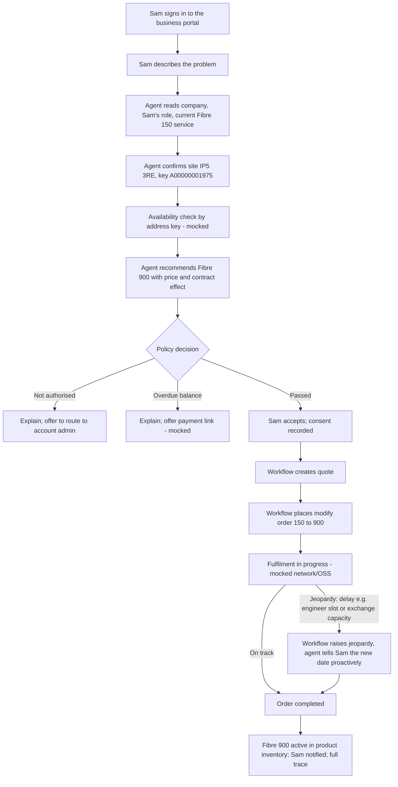

# AgenticTelco MVP: one-page design (DRAFT for LalitC sign-off)

**Status:** Draft, 27 Oct 2026. Nothing is built until LalitC approves this page.

## 1. Business scenario
Brightwell Design Ltd, a 25-person design agency, is expanding (hiring 15 people, moving to cloud video editing). It is on **AgenticTelco Fibre 150**, 14 months into a 24-month contract, and the line can't keep up. Sam, an authorised contact, opens the business portal and describes the problem in plain words. The agent recommends **AgenticTelco Fibre 900**; the customer never has to name a product.

**Why it matters:** upgrade in one conversation instead of an account-manager cycle, revenue growth from an expanding customer, protection before renewal, and every decision auditable.

**Success measures (demo measures, not real operator figures):** time from request to order, self-service completion rate, policy blocks per 100 requests.

## 2. Test data (all new AgenticTelco records; nothing existing changes)
| Item | Value | Real or example |
|---|---|---|
| Business account | Brightwell Design Ltd | Example |
| Site | 1 Fibre Way, Martlesham, Ipswich IP5 3RE | Postcode real (BT Adastral Park, opened 1975); street and business are examples |
| Address key | `A00000001975` (Openreach-style) | Example |
| Contacts | Sam (authorised contact); one regular employee (not authorised) | Example |
| Current service | AgenticTelco Fibre 150 Asset at that Location | Existing product |
| Target product | AgenticTelco Fibre 900 | Existing product and price |

Salesforce objects (standard, no custom fields): Account, Contact (+ role), Location (External Reference = address key), Address, Associated Location, Asset (Location field).

## 3. Business process flow

**Exception paths in the MVP:** (1) not authorised, (2) overdue balance, (3) **order jeopardy**: fulfilment is delayed, Sam is told the revised date proactively, and the order still completes.

**End state (must be demonstrated):** the order is `completed` in Salesforce and the customer's product inventory shows **Fibre 900 active** at the Martlesham site, replacing Fibre 150. A working service, not just an accepted order.

## 4. What each layer does (and leaves out)
| Layer | MVP job | Out of scope for now |
|---|---|---|
| L1 Intent | Simple portal chat; free-text need | Rich UI, full TMF921 intent model |
| L2 Agent | One agent: understand need, match to product, explain | Agent mesh, A2A, multiple models |
| L3 Data | Postgres: conversation, decisions, audit | Kafka, pgvector, semantic cache |
| L4 Policy | One OPA policy: authorised contact, no overdue balance (mocked), available at address key (mocked), upgrade-only mid-contract (rule present; downgrade not demoed) | Multiple policy packs |
| L5 Execution | Small coded workflow: quote, order, track fulfilment to completion, raise jeopardy and revised date, update inventory; idempotent | Operaton BPMN engine (full demo only) |
| L6 Salesforce SoR | Reads party, site, asset, catalogue; writes quote and order | OSS service order, qualification (org returns error) |
| L8 Observability | One OpenTelemetry trace per request in Jaeger | Grafana, Langfuse, inference gateway |

Rule unchanged: **the agent proposes, policy decides, the workflow writes.** No business rules sit in the agent or in Salesforce.

## 5. TMF mapping
| Step | TMF Open API | Served by |
|---|---|---|
| Company and contact role | TMF632 Party Management | Salesforce, native |
| Site and address key | TMF674 Geographic Site (TMF673 for postcode/street lookup) | Our layer, reading standard Location/Address |
| Current service | TMF637 Product Inventory | Salesforce, native |
| Availability at address key | TMF679 Product Offering Qualification | Mocked in our layer |
| Product and price | TMF620 Product Catalog | Salesforce, Apex TMF facade |
| Quote | TMF648 Quote | Salesforce, Apex TMF facade |
| Modify order and order state (acknowledged, inProgress, completed) | TMF622 Product Order (action `modify`) | Salesforce, Apex TMF facade |
| Fulfilment progress, jeopardy and revised date | TMF641 Service Order (milestones and jeopardy alerts; field support to be verified against the spec version) | Mocked OSS in our layer |
| Order status notification to Sam | TMF622 / TMF641 events via TMF688 Event pattern | Our layer |
| Service live | TMF637 Product Inventory: Fibre 900 active | Salesforce, native |

eTOM: Customer Order Handling (Fulfillment), preceded by a pre-order availability check. ODA: Core Commerce and Party Management only. This is conceptual alignment, not certified conformance.

## 6. Real vs mocked
Real: Salesforce reads and writes, catalogue and prices, policy decisions, workflow and undo, tracing.
Mocked and labelled in the demo: overdue-balance check, availability by address key, payment link, network fulfilment (OSS) and the jeopardy event that delays it.

## 7. Open items for sign-off
1. Approve the scenario, test data, the three exception paths and the end state (Fibre 900 active).
2. Confirm L5 in the MVP is a small coded workflow (not Operaton) to keep it light.
3. Confirm the MVP runs as a separate "MVP mode" alongside the full AgenticTelco demo.

## 8. Build items identified
1. Extend the TMF622 Apex facade to accept `action: modify` with a reference to the existing Fibre 150 product, mapping it to an order line that replaces Fibre 150 with Fibre 900 on the same service. Mapping only, no business rules in Salesforce (DevBot).

## 9. Layer walkthrough
A detailed, layer-by-layer explanation of this design (how we present it, the end-to-end sequence across all eight Zero Gravity layers, what each layer does in Brightwell's journey, example artefacts, real vs mocked, the proposed demo layer view and a CIO/CTO view) is in [layer-walkthrough.md](layer-walkthrough.md). It explains this page and does not change the business process. The walkthrough sets the journey in a fictional Tier 1 operator, "UK Telco" (illustrative), where Salesforce is one system among several legacy systems; the non-Salesforce systems are labelled legacy stand-ins.

Note on order jeopardy (checked 27 Oct 2026 against the tmforum-apis spec files, CONFIRMED): `productOrderJeopardyAlert`, `productOrderMilestone` and their events are in **TMF622 v5**, not v4.0.0; TMF641 v4.2.0 has `jeopardyAlert` and `milestone`. The order stays `inProgress` during the jeopardy. Details in the walkthrough, L5.

## 10. Enterprise Context (semantic layer)
**Agreed design (RECOMMENDED, our design, not specified by the Zero Gravity report).** The report places ontology, knowledge graphs and policy engines in L4 (p.22); this is our MVP form of it.

- **Semantic YAML** (in the repo) defines each business term once, mapped to its SID concept, its TMF API and its Salesforce source.
- **Context service** builds one **context pack** per request. **Both** the agent (through one MCP tool, `get_context`) and OPA receive the same pack, so the policy decides on exactly the facts the agent saw.
- **Provenance:** every fact in the pack names its source (Salesforce object, or mocked).
- **Identity matching** (which Salesforce account, billing customer and inventory site are the same customer) is deterministic and lives in **L3** as a maintained cross-reference with provenance per link, never in the agent and never fuzzy. An unverified link stops the workflow for human review. L4 builds the pack from the resolved identity: matching in L3, meaning in L4.

| Business term | SID concept | TMF API | Source |
|---|---|---|---|
| Customer | Customer role played by an Organization (Party) | TMF629 + TMF632 | Account |
| AuthorisedContact | Individual playing PartyRole "Authorised Buyer" | TMF632 / TMF669 | Account Contact Role = Decision Maker (regular employee = Business User) |
| Site | GeographicSite + GeographicAddress | TMF674 / TMF673 | Location (External Reference = address key), Address |
| CurrentBroadband | Product (inventory) | TMF637 | Asset at the Location |
| SpeedTier | ProductSpecCharacteristic (download speed) | TMF620 | Catalogue, read at run time, not hard-coded |
| ContractMonthsLeft | Derived from Agreement / CustomerAgreement | TMF651 | Asset end date, labelled as a stand-in |
| AvailableAtSite | ProductOfferingQualification result | TMF679 | Legacy stand-in (mocked), refreshed overnight |
| OverdueBalance | CustomerAccount balance / CustomerBill | TMF666 / TMF678 | Legacy stand-in (mocked billing, own customer ID) |

SID and TMF mappings are conceptual alignment (INFERRED), not certified.

Example context pack (illustrative values):
```json
{
  "customer": {"name": "Brightwell Design Ltd", "src": "salesforce:Account"},
  "requester": {"name": "Sam", "authorisedContact": true, "role": "Decision Maker", "src": "salesforce:AccountContactRole"},
  "site": {"addressKey": "A00000001975", "postcode": "IP5 3RE", "src": "salesforce:Location+Address"},
  "currentBroadband": {"product": "AgenticTelco Fibre 150", "downloadSpeedMbps": 150, "status": "active", "src": "salesforce:Asset via TMF637"},
  "contractMonthsLeft": {"value": 10, "src": "salesforce:Asset end date (stand-in for TMF651)"},
  "availableAtSite": {"value": ["AgenticTelco Fibre 500", "AgenticTelco Fibre 900"], "src": "mock:TMF679"},
  "overdueBalance": {"value": false, "src": "mock:billing"}
}
```

**Not in the MVP:** graph database, vector search. A graph extension on Postgres (for example Apache AGE) is a possible later step.
