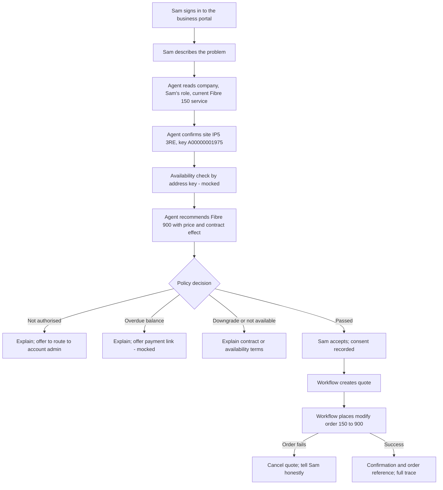

# AgenticTelco MVP: one-page design (DRAFT for LalitC sign-off)

**Status:** Draft, 27 Oct 2026. Nothing is built until LalitC approves this page.

## 1. Business scenario
Brightwell Design Ltd, a 25-person design agency, is expanding (hiring 15 people, moving to cloud video editing). It is on **AgenticTelco Fibre 150**, 14 months into a 24-month contract, and the line can't keep up. Sam, an authorised contact, opens the business portal and describes the problem in plain words. The agent recommends **AgenticTelco Fibre 900**; the customer never has to name a product.

**Why it matters:** upgrade in one conversation instead of an account-manager cycle, revenue growth from an expanding customer, protection before renewal, and every decision auditable.

**Success measures (demo measures, not real operator figures):** time from request to order, self-service completion rate, policy blocks per 100 requests.

## 2. Test data (all new AgenticTelco records; nothing existing changes)
| Item | Value | Real or example |
|---|---|---|
| Business account | Brightwell Design Ltd | Example |
| Site | 1 Fibre Way, Martlesham, Ipswich IP5 3RE | Postcode real (BT Adastral Park, opened 1975); street and business are examples |
| Address key | `A00000001975` (Openreach-style) | Example |
| Contacts | Sam (authorised contact); one regular employee (not authorised) | Example |
| Current service | AgenticTelco Fibre 150 Asset at that Location | Existing product |
| Target product | AgenticTelco Fibre 900 | Existing product and price |

Salesforce objects (standard, no custom fields): Account, Contact (+ role), Location (External Reference = address key), Address, Associated Location, Asset (Location field).

## 3. Business process flow

**Failure paths in the MVP:** (1) not authorised, (2) overdue balance, (3) mid-contract downgrade refused, (4) Salesforce order fails and the quote is undone.

## 4. What each layer does (and leaves out)
| Layer | MVP job | Out of scope for now |
|---|---|---|
| L1 Intent | Simple portal chat; free-text need | Rich UI, full TMF921 intent model |
| L2 Agent | One agent: understand need, match to product, explain | Agent mesh, A2A, multiple models |
| L3 Data | Postgres: conversation, decisions, audit | Kafka, pgvector, semantic cache |
| L4 Policy | One OPA policy: authorised contact, no overdue balance (mocked), available at address key (mocked), upgrade-only mid-contract | Multiple policy packs |
| L5 Execution | Small coded workflow: quote, order, confirm, with idempotency and undo | Operaton BPMN engine (full demo only) |
| L6 Salesforce SoR | Reads party, site, asset, catalogue; writes quote and order | OSS service order, qualification (org returns error) |
| L8 Observability | One OpenTelemetry trace per request in Jaeger | Grafana, Langfuse, inference gateway |

Rule unchanged: **the agent proposes, policy decides, the workflow writes.** No business rules sit in the agent or in Salesforce.

## 5. TMF mapping
| Step | TMF Open API | Served by |
|---|---|---|
| Company and contact role | TMF632 Party Management | Salesforce, native |
| Site and address key | TMF674 Geographic Site (TMF673 for postcode/street lookup) | Our layer, reading standard Location/Address |
| Current service | TMF637 Product Inventory | Salesforce, native |
| Availability at address key | TMF679 Product Offering Qualification | Mocked in our layer |
| Product and price | TMF620 Product Catalog | Salesforce, Apex TMF facade |
| Quote | TMF648 Quote | Salesforce, Apex TMF facade |
| Modify order | TMF622 Product Order (action `modify`) | Salesforce, Apex TMF facade |

eTOM: Customer Order Handling (Fulfillment), preceded by a pre-order availability check. ODA: Core Commerce and Party Management only. This is conceptual alignment, not certified conformance.

## 6. Real vs mocked
Real: Salesforce reads and writes, catalogue and prices, policy decisions, workflow and undo, tracing.
Mocked and labelled in the demo: overdue-balance check, availability by address key, payment link.

## 7. Open items for sign-off
1. Approve the scenario, test data and four failure paths.
2. Confirm L5 in the MVP is a small coded workflow (not Operaton) to keep it light.
3. Confirm the MVP runs as a separate "MVP mode" alongside the full AgenticTelco demo.
