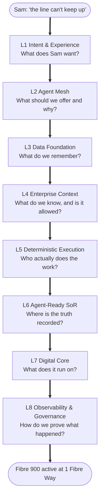
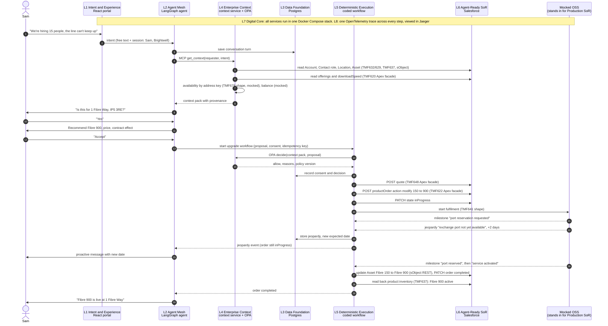
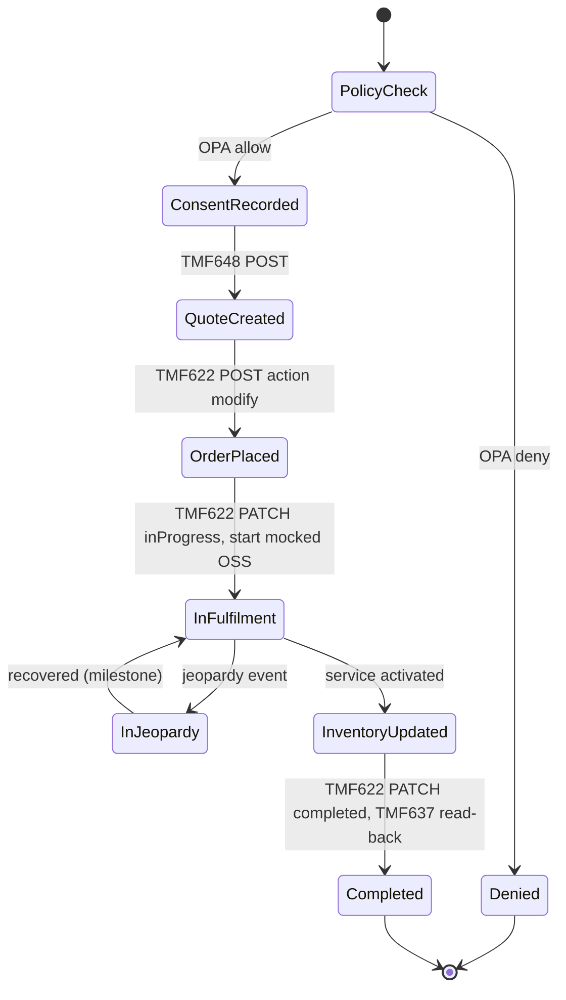

# AgenticTelco MVP: layer-by-layer architecture walkthrough

**Status:** Draft, 27 Oct 2026, for LalitC review. It explains the agreed MVP design ([MVP-design.md](MVP-design.md)); it does not change the business process. Nothing here is built until LalitC signs off.

**Labels.** **CONFIRMED**: a primary source states it (TM Forum spec file, the Zero Gravity report, our org capability check or our code). **REPORTED**: stated by someone else and not checked by us. **INFERRED**: our analysis. **RECOMMENDED**: our design choice. **UNKNOWN**: not known yet. All customer names, IDs, dates and prices below are **examples** unless marked otherwise.

**Layer names** follow TechM's Zero Gravity report, Figure 3 and its layer table (report p.21–22; see `/workspace/zero-gravity-analysis.md`). The report is a framework: it names no products, no TMF Open API numbers and no Salesforce role (CONFIRMED). Every technology choice, API mapping and screen below is **our design** (RECOMMENDED) unless it is quoted from the report.

---

## 1. How we present it (RECOMMENDED)

Four acts, about 20 minutes. The business process is the same in every act; only the depth changes.

**Act 1: The story (2 min, customer view only).** Show only Sam's chat. Sam describes the problem, is offered Fibre 900 with its price, accepts, is told proactively about the two-day delay at the exchange, and is told when the service is live. No architecture yet.

**Act 2: The same story, layer by layer (10 min).** Start with one stack picture showing Sam's journey as a line down through the eight layers. Then one screen per layer, each answering one question:



The line is a storytelling order, not the call order. The real call sequence is in section 3, and L7 and L8 sit under and across every step rather than at the end.

| Layer | Question on its screen |
|---|---|
| L1 | What does Sam want? |
| L2 | What should we offer and why? |
| L3 | What do we remember? |
| L4 | What do we know, and is it allowed? |
| L5 | Who actually does the work? |
| L6 | Where is the truth recorded? |
| L7 | What does it run on? |
| L8 | How do we prove what happened? |

**Act 3: The CIO/CTO view and the proof (5 min).** Run the live demo with the layer panel (section 7) lit up next to the chat. Then press **Not authorised**: a Business User asks for the same upgrade and the L4 policy, not the model, stops it, with the rule and reason on screen. Use the CIO/CTO questions in section 8 to frame it.

**Act 4: Real vs mocked, and MVP to scale (3 min).** Show the summary table (section 6) with every mocked item named, then the path from MVP to pilot to scale (section 8, question 6).

So the flow is: **customer story → layer walkthrough → CIO/CTO view → real vs mocked and MVP to scale.** Timings are approximate.

**Key message:** the agent proposes, policy decides, the workflow writes.

---

## 2. What changes for Sam

**Today.** Brightwell Design Ltd is growing and its Fibre 150 line can't cope. Sam phones or emails the account manager, who checks the contract, asks someone else whether faster fibre is available at 1 Fibre Way, prepares a quote, waits for Sam to sign, and keys the order. If the exchange has no free port, Sam usually finds out when the engineer doesn't turn up, or by chasing. Several people and several systems are involved, each holding part of the rules.

**In the agentic world.** Sam types the problem in plain words in the business portal: "We're hiring 15 people and moving to cloud video editing; the internet can't keep up." An agent already knows who Sam is, which site Brightwell is on and what it has today. It checks what is available at that address, recommends Fibre 900 with the price and what it means for the contract, and asks Sam to accept. A policy engine, not the agent, decides whether the upgrade is allowed. A deterministic workflow, not the agent, writes the quote and order into Salesforce. When the exchange port is late, the agent tells Sam the new date before Sam has to ask. When the order completes, Brightwell's product inventory shows Fibre 900 active. Every step is traceable.

**The rule behind it (RECOMMENDED, consistent with the Zero Gravity Axiom):** the agent proposes, policy decides, the workflow writes. Rules live in L4, not in the agent and not in Salesforce. The report's Axiom says rules and policies are "fully externalized, with zero residual left inside any agent-ready SoR" (CONFIRMED, report p.24).

---

## 3. End-to-end sequence (happy path with jeopardy)

L7 Digital Core is the runtime every box below runs on, and L8 records a span for every arrow. Both are shown as notes rather than participants.



---

## 4. Layer by layer

### L1 Intent & Experience

> **The question this layer answers: What does Sam want?**

**Zero Gravity says (CONFIRMED, p.21–22):** "multimodal, omnichannel capture of customer and operator intent as goal expressions across digital, voice, retail, and partner channels". It "extends ODA's Engagement Management".

**(a) Today vs agentic.** Today the customer picks from forms and product menus, or calls someone. In the agentic world the customer states a goal ("the line can't keep up with our growth") and never has to name a product.

**(b) Its job in Brightwell's journey.** The moment Sam signs in to the business portal and types the problem. It also shows the site confirmation, the recommendation card with an Accept button, and later the proactive jeopardy message and the "live" message.

**(c) Under the hood (RECOMMENDED).**

| Item | MVP choice |
|---|---|
| Component | React single-page portal with a chat panel and the proposed layer view (section 7) |
| OSS and licence | React, MIT (CONFIRMED, 06-tech-stack) |
| Input | Sam's free text; signed-in session (demo login, example) |
| Output | An intent envelope to L2; rendered agent messages and cards |
| TMF / SID | Intent is conceptually TMF921 Intent / TR292 TIO. **The MVP does not implement TMF921**; it sends a simple envelope. SID: Party (via the session). |

Example intent envelope (example values):

```json
{
  "intentId": "int-0001",
  "channel": "business-portal",
  "requester": {"contactId": "003-example-sam", "accountId": "001-example-brightwell"},
  "utterance": "We're hiring 15 people and moving to cloud video editing. The internet can't keep up.",
  "receivedAt": "2026-10-27T10:02:11Z",
  "traceparent": "00-<trace-id>-<span-id>-01"
}
```

**(d) On screen.** The chat on the left. In the layer panel, L1 lights first and shows this envelope.

**(e) Real vs mocked; out of scope.** Real: the portal and chat. Simplified: sign-in is a demo login. Out of scope: voice, retail and partner channels, rich UI, a full TMF921 intent model.

---

### L2 Agent Mesh

> **The question this layer answers: What should we offer and why?**

**Zero Gravity says (CONFIRMED, p.21–22):** "Goal-oriented AI agents reason over shared context, compose execution plans, and coordinate outcomes across domains without hard-coded integration logic." Protocols named: A2A, MCP and UCP (UCP is not defined in the report, UNKNOWN).

**(a) Today vs agentic.** Today the account manager interprets the request and moves between systems. In the agentic world an agent interprets the goal, reasons over a prepared context and proposes a plan, but it has no write access and makes no business decision.

**(b) Its job.** From Sam's first message to the recommendation; later, turning the workflow's jeopardy and completion events into plain messages for Sam.

**(c) Under the hood (RECOMMENDED).**

| Item | MVP choice |
|---|---|
| Component | One LangGraph agent (not a mesh) |
| OSS and licence | LangGraph, MIT; MCP Python SDK, MIT (CONFIRMED, 06-tech-stack) |
| Tools (MCP) | `get_context` (L4, read), `start_upgrade` (L5, start only), `get_order_status` (L5, read). **No tool writes to Salesforce.** |
| Input | Intent envelope; context pack; workflow events |
| Output | Messages to Sam; a proposal handed to L5 |
| TMF / SID | None directly. The agent sees only business terms from the context pack, never Salesforce object names |
| Model | Through the model provider configured in the stack; which model is used in the MVP is UNKNOWN (not fixed in the MVP design) |

Example agent plan and tool call (example values):

```json
{
  "plan": [
    "get_context for Sam and Brightwell",
    "confirm site with Sam",
    "match need (15 extra staff, cloud video) to eligible offerings by downloadSpeed",
    "present Fibre 900 with price and contract effect",
    "on acceptance, start_upgrade"
  ],
  "toolCall": {
    "name": "start_upgrade",
    "arguments": {
      "intentId": "int-0001",
      "fromProductId": "asset-example-fibre150",
      "toOfferingId": "AT-FIBRE-900",
      "consent": {"by": "Sam", "text": "I accept the upgrade to Fibre 900", "at": "2026-10-27T10:05:40Z"},
      "idempotencyKey": "int-0001-upgrade"
    }
  }
}
```

The recommendation itself is reasoning ("15 more people and cloud video need more than 150 Mbps; Fibre 900 is available at your site"). Whether the upgrade is *allowed* is not the agent's call; that is L4's OPA decision.

**(d) On screen.** L2 lights while it reasons. The panel shows the plan, each tool call and its result, and the wording of the recommendation.

**(e) Real vs mocked; out of scope.** Real: the agent and its tool calls. Out of scope: multiple agents, A2A, multiple models, an inference gateway, agent evaluation runs.

---

### L3 Data Foundation

> **The question this layer answers: What do we remember?**

**Zero Gravity says (CONFIRMED, p.21–22):** "Governed data products, Lakehouse architecture, semantic layers, AI/ML platforms, and real-time integration create a trustworthy substrate for agentic decisions." It "builds on ODA Intelligence Management".

**(a) Today vs agentic.** Today conversation notes, decisions and order history sit in different tools, if they are kept at all. In the agentic world every turn, decision and workflow step is stored with the same trace ID, so an outcome can be reconstructed and learned from.

**(b) Its job.** Throughout: storing Sam's conversation, the context pack used, the OPA decision, the consent, the workflow state, and the jeopardy and milestone history.

**(c) Under the hood (RECOMMENDED).**

| Item | MVP choice |
|---|---|
| Component | One PostgreSQL database |
| OSS and licence | PostgreSQL, PostgreSQL Licence (CONFIRMED, 06-tech-stack) |
| Tables | `conversation_turn`, `context_pack`, `policy_decision`, `consent`, `workflow_instance`, `workflow_step` (with idempotency key), `order_event` (milestones, jeopardy), `audit_log` |
| Input | Writes from L2, L4 and L5 |
| Output | Reads for the layer view, audit and replay |
| SID | Not a SID store; it holds our own operational records |

Example audit row (example values):

```json
{"traceId": "4bf92f35...", "layer": "L4", "event": "policy_decision", "decision": "allow",
 "policyVersion": "upgrade-v1", "inputHash": "sha256:...", "at": "2026-10-27T10:05:41Z"}
```

**(d) On screen.** L3 lights at each save and shows the row written.

**(e) Real vs mocked; out of scope.** Real: Postgres and everything stored in it. Honest gap: the report's L3 is a lakehouse with governed data products and MLOps. The MVP's L3 is one operational database, which is enough for the journey but is not a data foundation in the report's sense (INFERRED). Out of scope: Kafka, pgvector, semantic cache, data products, analytics.

---

### L4 Enterprise Context

> **The question this layer answers: What do we know, and is it allowed?**

**Zero Gravity says (CONFIRMED, p.21–22):** "A shared enterprise vocabulary (ontology, knowledge graphs, policy engines, commitment models, and memory services) provides the gravity-free center of the architecture." It references SID (GB922) and TR292 TIO. Note that the report puts **policy engines** in L4, so OPA belongs here.

**(a) Today vs agentic.** Today "authorised contact", "in contract" and "eligible" are defined differently in CRM, CPQ and order management, and the rules are buried inside them. In the agentic world each business term is defined once, the facts for one request are assembled into one context pack, and one policy engine decides on that same pack.

**(b) Its job.** Two moments: when the agent needs to understand Sam's situation (context pack), and when the workflow asks whether the upgrade is allowed (OPA decision).

**(c) Under the hood (RECOMMENDED).**

| Item | MVP choice |
|---|---|
| Components | Semantic YAML file (in the repo), context service (small Python service), OPA |
| OSS and licence | OPA, Apache-2.0 (CONFIRMED, 06-tech-stack); context service is our code |
| Input | Requester and intent; reads from L6 and the mocks |
| Output | A context pack (to L2 via one MCP tool, and to OPA as input); a policy decision (to L5) |

**Semantic definitions (corrected SID mapping).** SID concepts and TMF numbers are INFERRED alignment, not certified mappings.

| Business term | SID concept | TMF API | Source | Real or mocked |
|---|---|---|---|---|
| Customer | Customer role played by an Organization (Party) | TMF629 + TMF632 | Account | Real |
| AuthorisedContact | Individual playing PartyRole "Authorised Buyer" | TMF632 / TMF669 | Account Contact Role = **Decision Maker** (a regular employee is **Business User**) | Real |
| Site | GeographicSite + GeographicAddress | TMF674 / TMF673 | Location (External Reference = address key) + Address | Real |
| CurrentBroadband | Product (inventory) | TMF637 | Asset at that Location | Real |
| SpeedTier | ProductSpecCharacteristic, download speed | TMF620 | Catalogue, read at run time, not hard-coded. The existing code uses the characteristic name `downloadSpeedMbps` (CONFIRMED in `stack/`) | Real |
| ContractMonthsLeft | Derived from Agreement / CustomerAgreement | TMF651 | Asset end date, **labelled as a stand-in** for the agreement | Real data, stand-in source |
| AvailableAtSite | ProductOfferingQualification result | TMF679 | Our layer, by address key | **Mocked** (native TMF679 returns 400 on this org, CONFIRMED in org-capabilities) |
| OverdueBalance | CustomerAccount balance / CustomerBill | TMF666 / TMF678 | Mocked billing feed | **Mocked** |

Extract of the semantic YAML (RECOMMENDED shape):

```yaml
terms:
  AuthorisedContact:
    definition: A contact whose role at the organisation allows ordering.
    sid: Individual playing PartyRole "Authorised Buyer"
    tmf: [TMF632, TMF669]
    source: {object: AccountContactRole, where: "Role = 'Decision Maker'"}
  SpeedTier:
    definition: Download speed of an offering, from the catalogue.
    sid: ProductSpecCharacteristic
    tmf: TMF620
    source: {characteristic: downloadSpeedMbps}
  AvailableAtSite:
    definition: Offerings that can be delivered at the site's address key.
    sid: ProductOfferingQualification
    tmf: TMF679
    source: {mock: availability-by-address-key}
```

Example context pack (illustrative values; each fact carries provenance):

```json
{
  "packId": "ctx-0001",
  "customer": {"name": "Brightwell Design Ltd", "src": "salesforce:Account"},
  "requester": {"name": "Sam", "authorisedContact": true, "role": "Decision Maker", "src": "salesforce:AccountContactRole"},
  "site": {"addressKey": "A00000001975", "postcode": "IP5 3RE", "line1": "1 Fibre Way, Martlesham, Ipswich",
           "src": "salesforce:Location+Address"},
  "currentBroadband": {"product": "AgenticTelco Fibre 150", "downloadSpeedMbps": 150, "status": "active",
                       "src": "salesforce:Asset via TMF637"},
  "contractMonthsLeft": {"value": 10, "src": "salesforce:Asset end date (stand-in for TMF651 Agreement)"},
  "availableAtSite": {"value": ["AgenticTelco Fibre 500", "AgenticTelco Fibre 900"], "src": "mock:TMF679"},
  "overdueBalance": {"value": false, "src": "mock:billing"},
  "offerings": [{"id": "AT-FIBRE-900", "downloadSpeedMbps": 900, "monthlyPrice": 45.00,
                 "src": "salesforce:catalogue via TMF620 Apex facade"}]
}
```

The £45.00 term monthly price is the value in our seed catalogue for Fibre 900 (£27.00 for Fibre 150) (CONFIRMED in `seed/epc/catalog.json`); prices are read from Salesforce at run time. What the upgrade does to the contract term (continue the remaining 10 months, or restart a new term) is **not yet agreed** (UNKNOWN); the agent will state whatever the catalogue and policy data say.

OPA input and decision (example values). The input is the same context pack plus the proposal:

```json
{"input": {"context": {"packId": "ctx-0001", "...": "as above"},
           "proposal": {"action": "modify", "from": "AgenticTelco Fibre 150", "to": "AT-FIBRE-900"}}}
```

```json
{"result": {"allow": true, "reasons": [], "policyVersion": "upgrade-v1", "decisionId": "dec-0001"}}
```

Short Rego snippet (RECOMMENDED; OPA v1 syntax):

```rego
package agentictelco.upgrade

default allow := false

allow if count(deny) == 0

deny contains "not_authorised" if not input.context.requester.authorisedContact
deny contains "overdue_balance" if input.context.overdueBalance.value
deny contains "not_available_at_site" if not available
deny contains "downgrade_mid_contract" if {
  input.context.contractMonthsLeft.value > 0
  target_speed <= input.context.currentBroadband.downloadSpeedMbps
}

available if {
  some name in input.context.availableAtSite.value
  name == target.name
}

target := o if {
  some o in input.context.offerings
  o.id == input.proposal.to
}
target_speed := target.downloadSpeedMbps
```

(The snippet assumes the offering carries a `name`; the final pack schema is DevBot's to fix. Policies will have `opa test` unit tests, as in 05-security.)

**(d) On screen.** L4 lights twice: first with the context pack (provenance tags shown as "Salesforce" or "Mocked" chips), then with the OPA input, decision and the Rego rule that fired.

**(e) Real vs mocked; out of scope.** Real: semantic file, context service, OPA decisions, Salesforce-sourced facts. Mocked: availability and overdue balance. Out of scope: an ontology beyond this file, knowledge graph, vector search, memory services, commitment models. A graph extension such as Apache AGE (open source, on Postgres) is a possible later step (RECOMMENDED; licence to be checked before use).

---

### L5 Deterministic Execution Fabric

> **The question this layer answers: Who actually does the work?**

**Zero Gravity says (CONFIRMED, p.21–22):** "Composable orchestration, API gateways, event-driven choreography, and compensating transaction patterns execute agent plans safely. 'Deterministic' here means auditable, predictable, and fully compensated."

**(a) Today vs agentic.** Today orders are keyed by people and fallout is chased by people. In the agentic world the agent's accepted plan is executed by a workflow with fixed states, retries and compensation, and the agent never writes directly.

**(b) Its job.** From Sam's "Accept" to "Fibre 900 is live": call OPA, record consent, create the quote, place the modify order, drive fulfilment, raise the jeopardy and revised date, and complete the order.

**(c) Under the hood (RECOMMENDED).**

| Item | MVP choice |
|---|---|
| Component | Small coded workflow (Python) with a state machine persisted in Postgres. Operaton BPMN stays in the full demo only (open item 2 in MVP-design) |
| Idempotency | One key per intent (for example `int-0001-upgrade`) is passed as `externalId` to TMF622. The Apex facade already rejects a POST without `externalId` and is idempotent on it (CONFIRMED, `AgenticTelco_TMF622.cls`) |
| Input | Proposal and consent from L2; decision from OPA; events from the mocked OSS |
| Output | TMF648 and TMF622 calls to L6; events to L2; rows in L3 |

Workflow states:



**Jeopardy: what the TMF specs actually contain (CONFIRMED, read from the tmforum-apis GitHub spec files on 27 Oct 2026).** This corrects the earlier REPORTED note that TMF622 "v4 onwards" has a `jeopardyAlert` field:

| Spec | Order state | Jeopardy and milestones | Events |
|---|---|---|---|
| TMF622 v4.0.0 (`TMF622-ProductOrder-v4.0.0.swagger.json`) | `inProgress` exists | **No** jeopardy or milestone field on ProductOrder; `expectedCompletionDate` exists | No jeopardy or milestone event |
| TMF622 v5.0.0 (`TMF622-ProductOrdering-v5.0.0.oas.yaml`) | `inProgress` exists | `productOrderJeopardyAlert[]` (name, jeopardyType, message, alertDate, exception), `productOrderMilestone[]` (name, status, milestoneDate, message), `expectedCompletionDate` | `ProductOrderJeopardyAlertEvent`, `ProductOrderMilestoneEvent` |
| TMF641 v4.2.0 (`TMF641-ServiceOrdering-v4.2.0.swagger.json`) | `inProgress` exists | `jeopardyAlert[]`, `milestone[]`, `expectedCompletionDate` | `ServiceOrderJeopardyEvent`, `ServiceOrderMilestoneEvent` |

So in the MVP the jeopardy is modelled as: the mocked OSS raises a TMF641-shaped jeopardy on the service order; L5 reflects it at product-order level using the TMF622 **v5** field and event names. The order stays `inProgress` throughout (it does not move to `held` or `failed`).

Our Apex TMF622 facade does **not** store jeopardy or milestones today: it maps only `state` (Draft = acknowledged, Submitted = inProgress, Activated = completed) and writes order items with `action: add` (CONFIRMED, `AgenticTelco_TMF622.cls`). Adding `action: modify` is already build item 1. **Open item for DevBot (RECOMMENDED):** keep jeopardy and milestone history in L3 and emit it as TMF622 v5-shaped events from L5, rather than adding fields to the Salesforce Order, so no new Salesforce metadata is needed. If LalitC wants them visible in Salesforce, that is a separate decision.

Example jeopardy event from L5 (example values; field names CONFIRMED in TMF622 v5.0.0):

```json
{
  "eventType": "ProductOrderJeopardyAlertEvent",
  "eventTime": "2026-10-28T09:14:00Z",
  "event": {"productOrder": {
    "id": "801-example-order", "state": "inProgress",
    "expectedCompletionDate": "2026-11-05T17:00:00Z",
    "productOrderJeopardyAlert": [{
      "id": "ja-1", "name": "Exchange port not yet available", "jeopardyType": "Normal",
      "message": "No free port at the exchange; revised date +2 days", "alertDate": "2026-10-28T09:14:00Z"}],
    "productOrderMilestone": [{"id": "ms-1", "name": "Port reservation requested", "status": "done",
                               "milestoneDate": "2026-10-27T10:07:00Z"}]
  }}
}
```

`jeopardyType` example values in the spec description are "Normal, Hazard, Critical" (CONFIRMED); which value we use is our choice.

**(d) On screen.** L5 lights at each state change. The panel shows the state machine with the current state highlighted, the idempotency key, and the jeopardy event.

**(e) Real vs mocked; out of scope.** Real: the workflow, its states, idempotency and its calls to Salesforce. Mocked: the OSS that produces milestones and the jeopardy. Out of scope: Operaton BPMN, an API gateway, an event bus, full compensation of every step (the MVP journey has no rollback path to demonstrate).

---

### L6 Agent-Ready Systems of Record

> **The question this layer answers: Where is the truth recorded?**

**Zero Gravity says (CONFIRMED, p.21–22):** "Featherweight, domain-aligned systems store canonical facts, state, events, and lineage while exposing semantically aligned APIs and event streams." "Agent-ready" is "not a mandatory forklift upgrade": legacy BSS/OSS are "thinned". The report maps L6 to ODA Party Management, Core Commerce Management and Production, and names **no** TMF API numbers and **no** Salesforce role.

**(a) Today vs agentic.** Today CRM, CPQ and order management hold data *and* rules. In the agentic world Salesforce Communications Cloud keeps the canonical records (customer, site, product, quote, order) and nothing else; it is reached only through APIs.

**(b) Its job.** Supplying facts to L4 at the start, receiving the quote and order from L5, and finally showing Fibre 900 active.

**(c) Under the hood.** Per ADR-001 and ADR amendment 001 (CONFIRMED, approved by LalitC):

| Call | TMF API | How it is served | Label shown |
|---|---|---|---|
| Customer, contact role | TMF629 / TMF632 | Native Salesforce API | native Salesforce API |
| Current product | TMF637 read | Native Salesforce API | native Salesforce API |
| Site, address key | TMF674 / TMF673 shape | Our layer reading standard Location / Address (sObject REST) | native Salesforce API (sObject) |
| Catalogue, prices | TMF620 | `AgenticTelco_TMF620` Apex REST | custom Apex TMF facade on Salesforce |
| Quote | TMF648 | `AgenticTelco_TMF648` Apex REST | custom Apex TMF facade on Salesforce |
| Order | TMF622 | `AgenticTelco_TMF622` Apex REST (mapping only) | custom Apex TMF facade on Salesforce |
| Asset becomes Fibre 900 | TMF637 result | Asset written by our adapter through standard sObject REST, read back via TMF637 (the full demo does this today, CONFIRMED in `stack/l6_salesforce_adapter`) | native Salesforce API |

The facades hold no business rules, only TMF ↔ sObject mapping and state transitions, with test coverage of at least 85% (CONFIRMED, amendment 001: 97.3% at the last deploy). Nothing existing in the org is changed; only AgenticTelco records are created.

Example modify order request (example values; `action: modify` is a valid ProductOrderItem action in TMF622 v4 and v5, CONFIRMED; facade support is build item 1):

```json
POST /services/apexrest/agentictelco/tmf622/productOrder
{
  "externalId": "int-0001-upgrade",
  "relatedParty": [{"id": "001-example-brightwell", "role": "Customer"}],
  "quote": [{"id": "0Q0-example-quote"}],
  "productOrderItem": [{
    "id": "1", "action": "modify",
    "product": {"id": "02i-example-fibre150-asset"},
    "productOffering": {"id": "AT-FIBRE-900", "name": "AgenticTelco Fibre 900"}
  }]
}
```

Salesforce records at the end (example IDs): Order `Status = Activated` (TMF622 `completed`); Asset "AgenticTelco Fibre 900" at the Brightwell Location with `Status = Installed`, returned by TMF637 as `status: active`. Before activation the adapter creates the Subscription Management `AppUsageAssignment` that stops the org's assetize flow from failing (CONFIRMED, org-capabilities).

**(d) On screen.** L6 shows each TMF request and response, labelled **native Salesforce API** or **custom Apex TMF facade on Salesforce**, with links to the Salesforce records.

**(e) Real vs mocked; out of scope.** Real: all Salesforce reads and writes. Mocked: availability (TMF679) and the OSS (TMF641). Out of scope: billing and balance from a real SoR, Salesforce OSS service orders, native TMF679 qualification.

---

### L7 Digital Core

> **The question this layer answers: What does it run on?**

**Zero Gravity says (CONFIRMED, p.21–22):** "Hybrid and multi-cloud compute, containerized platforms, zero-trust security, identity management, network virtualization, and edge capabilities provide the technical base." It is "the standardized cloud-native runtime that deploys, secures and operates ODA components", with identity "for humans & agents".

**(a) Today vs agentic.** Today each application has its own hosting and access set-up. In the agentic world every layer runs on one standard runtime, where agents get their own identities and secrets never reach the browser.

**(b) Its job.** It doesn't have a "moment" in the conversation; it is what everything runs on, from Sam's first message to the last.

**(c) Under the hood (RECOMMENDED), stated honestly:**

| Concern | MVP | Gap against the report's L7 |
|---|---|---|
| Runtime | One Docker Compose stack on one small host: portal, agent, context service, OPA, workflow, Postgres, OSS mock, L6 adapter, OTel collector, Jaeger | No Kubernetes, multi-cloud, edge or ODA Canvas |
| Licence | Docker Compose, Apache-2.0; use Docker Engine on Linux (Docker Desktop has separate commercial terms, INFERRED) | — |
| Secrets | From the environment on the host; Salesforce access only server-side via the Salesforce CLI session (CONFIRMED, amendment 001); never in the browser, repo, logs or traces | No secret manager |
| Network | One internal Compose network; only the portal is exposed | No zero-trust service mesh |
| Identity | Demo login for Sam; the agent's tools are scoped (read-only or start-only) | No separate workload identity for the agent |

Example artefact: the `docker compose ps` service list and the internal network map.

**(d) On screen.** An L7 card listing the running containers and their health, the network boundary, and a note that credentials stay on the server.

**(e) Real vs mocked; out of scope.** Real: the containers and network. Simplified: identity and secrets. Out of scope: Kubernetes (k3s), inference gateway, agent identity, zero-trust controls.

---

### L8 Observability & Governance

> **The question this layer answers: How do we prove what happened?**

**Zero Gravity says (CONFIRMED, p.21–22):** "End-to-end lineage, agent audit trails, policy-as-code guardrails, data quality monitoring, outcome metrics, and compliance automation span every layer."

**(a) Today vs agentic.** Today reconstructing why an order was placed means reading several systems' logs. In the agentic world one trace links Sam's words, the facts used, the decision, every API call and the final record.

**(b) Its job.** Every step; it is what lets us answer "why did this happen?" after the demo.

**(c) Under the hood (RECOMMENDED).** OpenTelemetry SDK and collector, Apache-2.0; Jaeger, Apache-2.0 (CONFIRMED, 06-tech-stack). One trace per request; `Authorization` headers redacted (05-security). Policy-as-code governance is the Rego in Git with tests and the decision log in L3.

Expected spans (names are RECOMMENDED):

| Span | Layer | Key attributes |
|---|---|---|
| `l1.intent.receive` | L1 | intentId |
| `l2.agent.plan`, `l2.tool.get_context`, `l2.tool.start_upgrade` | L2 | tool name, model, tokens |
| `l4.context.build` | L4 | packId, sources (Salesforce or mock) |
| `l4.opa.decide` | L4 | decisionId, allow, reasons, policy version |
| `l3.db.write` | L3 | table |
| `l5.workflow.step` (one per state) | L5 | state, idempotency key |
| `l6.tmf648.post`, `l6.tmf622.post`, `l6.tmf622.patch`, `l6.tmf637.get` | L6 | HTTP status, runtime label (native or Apex facade) |
| `oss.mock.jeopardy`, `oss.mock.milestone` | mocked OSS | jeopardy name, new date |

**(d) On screen.** An L8 strip under the layer panel showing the trace ID and a link to open it in Jaeger.

**(e) Real vs mocked; out of scope.** Real: traces and audit rows. Out of scope: Grafana dashboards, Langfuse agent traces and evaluations, data-quality monitoring, outcome metrics, compliance automation.

---

## 5. Exception paths: who decides

| Scenario | What happens | Which layer makes the call |
|---|---|---|
| Not authorised (a Business User asks) | Agent explains and offers to route to the account admin; no quote or order | **L4 OPA** denies (`not_authorised`); L2 explains |
| Overdue balance | Agent explains and offers a payment link (mocked) | **L4 OPA** denies (`overdue_balance`) |
| Order jeopardy that recovers | Order stays `inProgress`, Sam is told the new date, order completes | **L5** raises it from the mocked OSS; **L2** tells Sam |

## 6. Summary table

| Layer | Artefact shown | Real or mocked |
|---|---|---|
| L1 Intent & Experience | Intent envelope, chat | Real (demo login) |
| L2 Agent Mesh | Plan, MCP tool calls, recommendation | Real |
| L3 Data Foundation | Conversation, decision, consent, workflow and audit rows | Real |
| L4 Enterprise Context | Semantic terms, context pack with provenance, OPA input, decision and Rego | Real; availability and balance mocked |
| L5 Deterministic Execution | State machine, idempotency key, jeopardy event | Real workflow; OSS events mocked |
| L6 Agent-Ready SoR | TMF requests and responses, Salesforce record links | Real Salesforce; TMF679 and TMF641 mocked |
| L7 Digital Core | Running containers, network boundary, secrets note | Real (single host) |
| L8 Observability & Governance | Trace ID, span list, Jaeger link | Real |

---

## 7. Proposed demo layer view (PROPOSAL, pending LalitC sign-off)

This adopts DevBot's proposal. It is a design for DevBot to build only after LalitC approves it.

**Split screen.** Sam's chat on the left. On the right, a vertical panel with all **eight** layers, L1 to L8, using the Zero Gravity names (L1 Intent & Experience, L2 Agent Mesh, L3 Data Foundation, L4 Enterprise Context, L5 Deterministic Execution, L6 Agent-Ready SoR, L7 Digital Core, L8 Observability & Governance). As the request moves, each layer lights up and shows a one-line summary of its input and output. Clicking any layer opens what it did **for this request, with the real data**:

| Layer | Click-through content |
|---|---|
| L1 | The intent envelope |
| L2 | Plan, tool calls and results, final wording |
| L3 | Rows written in Postgres (conversation, decisions, audit) |
| L4 | Semantic definitions used, the context pack with "Salesforce" or "Mocked" provenance chips, the OPA input, decision and rule |
| L5 | State machine with current state, idempotency key, milestones and jeopardy |
| L6 | Each TMF call's request and response, labelled **native Salesforce API** or **custom Apex TMF facade on Salesforce**, with links to the Salesforce records |
| L7 | Containers and health, network boundary, "credentials stay server-side" |
| L8 | Trace ID, span list, link to Jaeger |

**Presenter mode.** A "Step" button that pauses after each layer, so a presenter can explain it before moving on.

**Architecture tab.** One card per layer: purpose (quoting the Zero Gravity description), the OSS used and its licence, its contract with neighbouring layers (what it receives and returns), and what is real or mocked in the MVP.

**Three scenario buttons.**

| Button | Shows | Deciding layer |
|---|---|---|
| Happy path (with jeopardy) | Full journey to Fibre 900 active, including the +2-day delay | L5 raises the jeopardy, L2 tells Sam |
| Not authorised | Business User asks; no order | L4 OPA denies |
| Overdue balance | Mocked arrears; no order | L4 OPA denies |

Mocked values are always shown with a "Mocked" label on screen.

---

## 8. CIO/CTO view (DRAFT, pending LalitC sign-off)

The questions a CIO or CTO is likely to ask, with our answer and where the demo shows it. Answers are our position (RECOMMENDED) unless labelled otherwise.

| # | Question | Answer | Where the demo shows it |
|---|---|---|---|
| 1 | Do we have to replace Salesforce or our BSS? | No. Salesforce Communications Cloud stays the system of record (L6) and is reached through standard Salesforce APIs and TMF Open APIs (native TMF629, TMF632, TMF637; mapping-only Apex facades for TMF620, TMF622, TMF648, TMF671). CONFIRMED (ADR-001, amendment 001) | L6 panel: each call labelled native or Apex facade, with record links |
| 2 | Who is in control, the AI or us? | The agent proposes, policy decides, the workflow writes. The agent has no write tools and cannot bypass authorisation, consent or financial checks | **Not authorised** and **Overdue balance** buttons: L4 OPA denies, nothing is written |
| 3 | Are we locking ourselves in? | Layers talk to each other through TMF Open API contracts; everything outside Salesforce is open source (licences in 06-tech-stack). The Apex facades are mapping-only, so they can be swapped for native APIs without changing the agent or workflow. Wording: **aligned with ODA, not certified** | Architecture tab (OSS and licence per layer); L6 labels |
| 4 | Is it safe and compliant? | Every decision is traced and audited: context used, policy version, decision, consent and every API call (L3, L8). Data residency: **designed for UK residency; MVP hosting not yet verified UK-only**. The GitHub Pages replay, the Salesforce org region and the model hosting location are all unverified (UNKNOWN) | L8 trace and Jaeger link; L4 decision; L3 audit rows |
| 5 | What will it cost to run? | We show the actual model calls and tokens for each request from the trace. An agent makes several model calls per request, so cost is per request, not per conversation. We give no cost figures until we have measured ones | L2 panel and L8 spans: model calls and token counts |
| 6 | What is the path to production? | **MVP** (this demo, one journey, one small stack) → **pilot** (one operator journey with real data) → **scale** (more journeys and agents). What changes: the runtime platform (L7: Kubernetes, secret management, agent identity), real availability (TMF679 against real qualification), real billing and balance, real OSS fulfilment (TMF641), and a BPMN engine (Operaton) where process visibility is needed. The layer contracts stay the same (INFERRED) | Summary table (section 6) and Architecture tab |
| 7 | How does it fit ODA? | Additive: nothing is ripped out. The portal and agent sit conceptually with ODA Engagement Management and Intelligence Management; Salesforce sits with Core Commerce Management and Party Management. INFERRED conceptual mapping; block names to be verified against TM Forum ODA documents. The report itself says L1 extends Engagement Management, L3 builds on Intelligence Management, and L6 corresponds to Party, Core Commerce and Production (CONFIRMED, p.21) | Architecture tab |
| 8 | What is the business case for a pilot? | Measure, against the operator's own baseline: order cycle time, right-first-time orders, cost per upgrade, and inbound "where's my order?" calls avoided by proactive jeopardy messages. **No figures until a pilot has measured them** | Happy path: proactive jeopardy message; timestamps in the trace |
| 9 | Who owns the rules? | The business owns the policies, as versioned rules (Rego in Git) with change control and tests. IT owns the platform. The agent owns neither | L4 panel: policy version and the rule that fired |

**Link to the MWC27 Autonomous Enterprise theme.** The repo records the team's report that TechM sponsors this theme; the sponsor name is not confirmed (REPORTED, open item O11 in 07-risks). The Zero Gravity report quotes TM Forum's CEO: operators that want to become autonomous enterprises "must first build trusted foundations, shared understanding and governance that allow AI to operate safely and at scale" (CONFIRMED, report p.6, Nik Willetts). This MVP is that first, governed step on one journey: one SME upgrade, end to end, with every rule outside the agent and outside Salesforce.

---

## 9. Open points and unverified items

1. **TMF622 jeopardy fields (CONFIRMED correction):** jeopardy and milestone fields are in TMF622 **v5** (`productOrderJeopardyAlert`, `productOrderMilestone`), not v4.0.0. TMF641 v4.2.0 has `jeopardyAlert` and `milestone`. The earlier note in chat was wrong on this point.
2. **Where jeopardy history lives:** RECOMMENDED in L3 with TMF622 v5-shaped events from L5; Salesforce Order unchanged. Needs DevBot's and LalitC's agreement.
3. **Contract effect of a mid-contract upgrade:** UNKNOWN; needs a business decision before the agent can state it.
4. **Model used by the agent in the MVP:** UNKNOWN.
5. **SID mapping:** INFERRED alignment, not checked ABE by ABE against GB922. TMF669 and TMF651 are listed for alignment only; they are not called in the MVP.
6. **Apache AGE:** a later option only; licence and fit to be checked before use.
7. The MVP is aligned to ODA functional blocks and uses TMF Open API contracts; it is **not** ODA- or TMF-certified.
